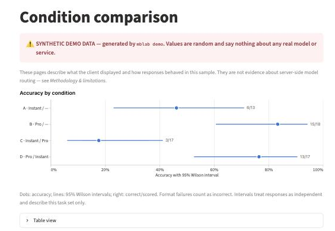

# Model Behavior Lab

> **Does your AI actually behave as configured?**

[](https://github.com/cynkai/model-behavior-lab/actions/workflows/ci.yml)
[](LICENSE)


Model Behavior Lab is a small, local-first toolkit for **reproducible experiments on AI
service settings** — which model is selected, which reasoning effort applies — and for
reporting **only what was actually observed, with its limits stated**.

The first experiment is about the ChatGPT mobile app. A default model can be chosen in
the model picker, and a different one can be chosen for a single message by
long-pressing the send button. When the two disagree (default *Instant*, per-message
*Pro*), which one does the response reflect? When both are the same (*Extra High* twice),
does anything change?

**This project does not assume an answer.** It keeps four kinds of statements apart —
documented facts, hypotheses, observations, and things that cannot be observed — and
every report says which is which.



<sub>The dashboard on **synthetic demo data** (`mblab demo`). The values are random and describe no real model or service. The repository contains no experimental results.</sub>

[한국어 README](docs/README.ko.md) · [Methodology](docs/methodology.md) · [Experiment protocol](docs/experiment-protocol.md) · [Contributing](CONTRIBUTING.md)

---

## Contents

- [Why](#why) · [What it does — and does not](#what-it-does--and-does-not)
- [Quick start](#quick-start) · [Commands](#commands) · [Study directory](#study-directory)
- [The first experiment](#the-first-experiment) · [Official-API studies](#official-api-studies-reasoning-effort) · [Dashboard](#dashboard)
- [Methodology in brief](#methodology-in-brief) · [Data, privacy, terms of service](#data-privacy-and-terms-of-service)
- [Known limitations](#known-limitations) · [Contributing](#contributing) · [Roadmap](#roadmap)

## Why

AI clients offer several ways to choose a model or a reasoning effort, and how those
settings interact is not always documented. Claims about them tend to be anecdotes
("it felt smarter"), and benchmarks usually compare *models*, not *settings* — without
recording the client, its version, or how a run was configured.

Answering "which setting was applied?" honestly needs a pre-registered protocol, a
randomized run order, structured records of what the client showed, conservative
statistics, and an explicit list of what the data cannot show. That is what this tool
provides.

## What it does — and does not

**It does**

- Define experiments in YAML: conditions, tasks, scoring rules, hypotheses, confounders.
  The definition is hashed and snapshotted when the run plan is generated, so later
  edits (for example to an answer key) are detected and reported.
- Generate a seeded, randomized run order (`4 conditions × 6 tasks × 3 repetitions = 72`
  runs for the first experiment), reproducible across Python versions.
- Record observations by hand — interactive CLI, a CSV you fill in a spreadsheet, or a
  form in the local dashboard — and validate them (duplicates, missing runs, prompt
  wording, confounders, client-version changes, mixed demo/real data, personal data).
- Score responses automatically (exact match, regex, numeric) or by blind manual grading.
- Run the same tasks through the provider's **official API** (OpenAI Responses API) to
  compare reasoning-effort levels of one model, as a separate execution method with its
  own studies (`mblab run-api`).
- Summarise per condition with uncertainty (Wilson / Newcombe intervals, seeded
  bootstrap), compare per-message settings against reference conditions with an explicit
  decision table, and write a Markdown report and a local dashboard.

**It does not**

- Automate, scrape, or intercept the ChatGPT client, or use any private API.
- Infer server-side model identity, routing, or hidden reasoning tokens. Those are not
  observable in a UI experiment, and the reports say so. In an API study, the model id
  and token counts the API reports are recorded as returned — never filled in or guessed.
- Pool UI and API results. They are different environments, compared side by side only.
- Ship results. There is no observed data in this repository. Demo data is generated on
  your machine, is random, and is labelled **SYNTHETIC** everywhere it appears.

## Quick start

Requires Python 3.11 or newer.

```bash
git clone https://github.com/cynkai/model-behavior-lab.git
cd model-behavior-lab
python3 -m venv .venv
source .venv/bin/activate          # Windows: .venv\Scripts\activate
pip install -e ".[dashboard]"
mblab --version
```

With [uv](https://docs.astral.sh/uv/) instead: `uv sync --extra dashboard`, then prefix
commands with `uv run` (for example `uv run mblab --version`). `uv.lock` pins the exact
versions used in CI.

### 1. Try it on synthetic demo data

```bash
mblab demo demo-study            # random values, labelled SYNTHETIC everywhere
mblab validate -s demo-study
mblab analyze -s demo-study
mblab report -s demo-study       # writes demo-study/reports/report.md
mblab dashboard -s demo-study    # opens http://localhost:8501
```

### 2. Run the real experiment

```bash
mblab init my-study              # creates my-study/experiment.yaml from the template
# Edit my-study/experiment.yaml: set `platform`, and copy the option labels exactly
# as your app shows them. Settle the definition before collecting any data.
mblab plan -s my-study           # 72 runs in a seeded random order
mblab next -s my-study --copy    # what to set in the app, plus the exact prompt (copied)
mblab record -s my-study         # type in what the app showed, run by run
mblab status -s my-study         # progress and the next run
mblab validate -s my-study
mblab analyze -s my-study
mblab report -s my-study
```

Prefer a spreadsheet? `mblab template -s my-study` writes a CSV with one row per planned
run; fill in rows and `mblab import my-study/exports/entry-template.csv -s my-study`.
The dashboard's *Run plan & recording* page has an entry form as well. The step-by-step
procedure — app settings, timing, what counts as a deviation — is in
[docs/experiment-protocol.md](docs/experiment-protocol.md).

## Commands

Every command takes `--study/-s DIR` (default: the current directory, or `$MBLAB_STUDY`).
`mblab <command> --help` lists all options.

| Command | What it does |
|---|---|
| `mblab init DIR` | Create a study directory with `experiment.yaml` from a template |
| `mblab plan` | Generate the randomized run order (`plan.json`), with the definition hash and snapshot |
| `mblab status` | Progress per condition, the next run, a validation summary |
| `mblab next [--copy]` | Show the next run: what to set in the client and the exact prompt |
| `mblab record` | Record one run interactively (`--response-file`, `--paste`, `--run-id`, `--replace`) |
| `mblab run-api` | Send the pending runs of an official-API study through the OpenAI Responses API (`--dry-run`, `--limit N`, `--min-interval`, `--yes`); needs the `api` extra and `OPENAI_API_KEY` |
| `mblab template` | Write a CSV entry template, one row per planned run |
| `mblab import FILE` | Import a filled CSV, a JSON array, or JSON lines — all rows valid or nothing is imported (`--dry-run`, `--replace`, `--default-tz`) |
| `mblab validate` | Check definition, plan, records, and grades (`--strict` fails on warnings) |
| `mblab grade export` / `mblab grade import SHEET` | Blind grading sheet without condition information, and importing the points |
| `mblab analyze [--json FILE]` | Score responses and summarise per condition, with uncertainty |
| `mblab export [--format csv\|json]` | One row per recorded run, with its score |
| `mblab report` | Markdown report (`reports/report.md`) |
| `mblab dashboard` | Local web dashboard (needs the `dashboard` extra) |
| `mblab demo DIR` | Create a synthetic demo study |

## Study directory

```text
my-study/
  experiment.yaml   # the pre-registered definition (you edit this before collecting)
  plan.json         # randomized order + definition hash and snapshot
  records.jsonl     # one observed run per line
  grades.jsonl      # manual grades, if a task is graded by hand
  grading/          # blind sheet (for graders) and its key (not for graders)
  reports/          # report.md, analysis.json
  exports/          # entry template, results.csv / results.json
```

Everything is a local file. There is no database and no server-side component.

## The first experiment

**ChatGPT Model Selection Override Experiment** — bundled template
[`chatgpt-model-selection-override`](src/mblab/templates/chatgpt-model-selection-override.yaml).

| Condition | Default selection | Per-message selection (long-press send) | Role |
|---|---|---|---|
| A | Instant | — | control |
| B | Pro | — | control |
| C | Instant | Pro | test (H1 predicts C behaves like B) |
| D | Pro | Instant | test (H1 predicts D behaves like A) |

- **H1** — when the two selections differ, the response reflects the per-message
  selection. **H1-alt** — it reflects the default. Neither is assumed.
- Six automatically scored tasks (elapsed time, calendar offset, letter count, a seating
  puzzle, a digit-sum count, a code trace). Every reference answer is recomputed
  independently in [`tests/test_template_answers.py`](tests/test_template_answers.py).
- 3 repetitions → 72 runs, one new conversation each, in a blocked random order.
  72 is an exploratory size, not a sample size chosen for statistical power.

Adding conditions is a matter of adding entries. The template contains commented-out
examples for *Extra High + Extra High* (the "stacked" case) and *Extra High + Instant*:

```yaml
selection_options:
  - id: extra-high
    label: Extra High            # exactly as your client shows it
conditions:
  - id: E
    model_selection: extra-high
    message_override: null
  - id: F                        # same setting chosen twice
    model_selection: extra-high
    message_override: extra-high
```

## Official-API studies (reasoning effort)

A second bundled template,
[`openai-reasoning-effort`](src/mblab/templates/openai-reasoning-effort.yaml), compares
`reasoning.effort` levels (low / medium / high) of **one model** through the official
OpenAI Python SDK and the Responses API, on the same six tasks as the UI experiment
(3 conditions × 6 tasks × 3 repetitions = 54 requests).

```bash
pip install -e ".[api]"                     # or: uv sync --extra api
mblab init api-study --template openai-reasoning-effort
# Edit api-study/experiment.yaml: set api.model and the effort levels it accepts.
mblab plan -s api-study
mblab run-api -s api-study --dry-run       # prints every request; sends nothing, costs nothing
export OPENAI_API_KEY=...                   # read from the environment only, never stored
mblab run-api -s api-study --limit 6       # asks before sending; re-run to resume
mblab analyze -s api-study
mblab report -s api-study
```

- **Cost.** Every request is billed to the account of the key — input and output tokens,
  with reasoning tokens counted as output. Higher effort usually means more tokens. The
  tool does not estimate cost; reports list token totals per condition so you can price
  them with the provider's current price list. A pre-registered `max_output_tokens` caps
  each request, and a response that reaches it is recorded as *incomplete* and reported.
  A request that times out may still be billed, and the runner retries it.
- **What is recorded.** The request is fully determined by the plan and the definition
  hash. From each response, the runner copies the model id, status, echoed effort,
  service tier, incomplete reason, and token usage (including reasoning tokens) into
  `api_reported` — exactly as returned; a value the API did not return stays empty.
  Latency comes from a client-side timer (`client_timer`).
- **Safety.** The key is read from `OPENAI_API_KEY` only, passed straight to the SDK,
  and never printed or written to any file. Requests use `store=false`, are paced
  (`--min-interval`, default 1 s), and run in plan order. Each record is saved as soon as
  its response arrives; errors write nothing, so re-running resumes where it stopped.
  `run-api` refuses to send if `experiment.yaml` changed after the plan.
- **UI vs. API.** A study uses one execution method. API results describe API access
  with this account and model id — not the ChatGPT app — and are compared with UI
  studies side by side, never pooled.

## Dashboard

`mblab dashboard -s <study>` starts a local [Streamlit](https://streamlit.io) app. It
listens on `localhost` only (pass `--address` to change that deliberately) and starts with
Streamlit's usage statistics switched off. Pages:

- **Overview** — research question, pre-registered hypotheses, documented facts (if
  any), collection progress, environment, validation issues.
- **Run plan & recording** — the randomized order, the next run's settings, the exact
  prompt with a copy button, and an entry form (disabled for demo studies).
- **Condition comparison** — accuracy with Wilson intervals, response-time distribution
  (per measurement method), displayed-label classes, per-message vs. default
  assessments, hypothesis tallies, pairwise differences.
- **Task-level results** — per-task accuracy heatmap and every repetition of every task,
  including runs not recorded yet.
- **Individual responses** — filter and read single runs with their score details.
- **Methodology & limitations** — what is and is not observable, the claims ledger,
  scoring rules, statistics, reproduction info.

Charts are drawn only from recorded data; with no data, a page says so instead of
showing an empty or placeholder chart. Every chart has a table view.

## Methodology in brief

The full write-up is [docs/methodology.md](docs/methodology.md).

| Observed directly (manual UI) | Not observable here |
|---|---|
| The prompt sent and the response text displayed | The server-side model that produced a response |
| The model label the client displayed, verbatim | Routing, automatic switching, fallback |
| Whether a thinking indicator appeared, and the time it displayed | Hidden reasoning tokens or compute |
| Response time by stopwatch (low precision) | Server-side experiments on the account |
| Client version, platform, date, declared confounders | |

- **Pre-registration.** Scoring rules, label aliases, and hypotheses live in
  `experiment.yaml` and are hashed into the plan. A reference answer must pass its own
  scoring rule, or the definition is rejected.
- **Metrics.** Accuracy (format failures count as incorrect, and are reported
  separately); task success rate (errors and refusals count as failures); response time
  per measurement method, never pooled; thinking-indicator rate; displayed-label classes.
- **Statistics.** 95% Wilson intervals, Newcombe intervals for differences of
  proportions, percentile bootstrap (seeded) for differences of medians. Groups with
  fewer than 5 observations are not compared. Intervals assume independent responses and
  describe this fixed task set only.
- **Per-message vs. default.** For a condition such as C (Instant + Pro), a metric can
  only indicate which selection applied if the two reference conditions (A and B) differ
  on it. If they do not, the result is *references not distinguishable*. Otherwise the
  result is *consistent with the per-message selection*, *consistent with the default*,
  *differs from both*, or *inconclusive* — never "proven".
- **Wording.** Reports say "consistent with", "not distinguishable", "not observable".
  A test fails the build if generated text uses words like "proves" or "confirms".

## Data, privacy, and terms of service

- Nothing is automated. You operate the official app yourself and type in what it
  showed. There is no scraping, request interception, reverse engineering, or private
  API use.
- Nothing is collected automatically. Only what you enter is stored, in local files.
  The dashboard listens on `localhost` only and starts with Streamlit's usage statistics
  turned off.
- Use fresh conversations with neutral prompts; do not paste personal conversations.
  `mblab validate` scans recorded text for e-mail addresses, phone numbers, card numbers,
  and API keys (without printing them) before you share a study.
- No API key is needed for UI studies. Official-API studies read the key from
  `OPENAI_API_KEY` only, pass it to the official SDK, and never print it or write it to
  disk; error messages are scrubbed of it. Requests are sent with `store=false`.

## Known limitations

- A displayed label is what the client showed — not a server-side record.
- Behavioural proxies (accuracy, time, thinking indicator) can change for reasons other
  than model selection: load, server-side experiments, usage limits, app updates.
- Stopwatch times include reaction, network, and rendering time (roughly ±1 s); they are
  not comparable with API latency.
- 18 responses per condition can reveal only large differences. Intervals assume
  independence and do not generalise beyond the six tasks.
- One account, one device, one period. The service can change without notice, so a
  result may not hold next week.
- The experimenter cannot be blind to the condition they set; scoring is automatic, and
  manual grading uses a blind sheet, but response style can still hint at the condition.
- UI experiments and official-API measurements are different domains. A study uses one
  execution method, records of the other kind are rejected, and results are compared
  side by side, never pooled.
- API-reported values (model id, token counts, echoed effort) are the provider's figures,
  not independently verified. How a reasoning-effort setting is applied internally is
  not observable.

## Contributing

Bug reports, task proposals, documentation fixes, and independent replications are
welcome — see [CONTRIBUTING.md](CONTRIBUTING.md). To share results, share the whole
study directory (after the privacy check) so others can run `mblab validate` and
`mblab report` and get the same numbers; the *Result submission* issue template lists
what to include.

## Roadmap

- [x] Official API runner (reasoning-effort levels of one model, OpenAI Responses API), as
  its own execution method — `mblab run-api`

Not implemented yet; the data model separates execution methods so these can be added
without changing UI experiments:

- [ ] Anthropic and Google API runners
- [ ] Cost per reasoning-effort level (API) — reports list token totals; no price data yet
- [ ] Cross-study comparison: iOS vs. Android vs. web
- [ ] Aggregating independent replications; publishing reports on GitHub Pages
- [ ] Detecting behaviour changes across client or model versions over time
- [ ] Task packs and benchmark-dataset plugins
- [ ] Inter-rater agreement for manual grading

## License

[MIT](LICENSE)
