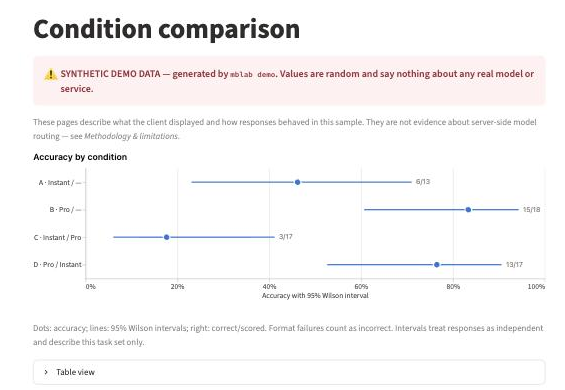

# Model Behavior Lab (한국어)

> **AI는 정말 설정한 대로 동작할까?**

Model Behavior Lab은 AI 서비스의 설정 — 어떤 모델을 골랐는지, 어떤 추론 수준(reasoning
effort)이 적용되는지 — 이 실제 응답 동작에 어떤 영향을 주는지 **재현 가능한 방식으로
실험**하고, **실제로 관측한 것만, 한계와 함께** 보고하기 위한 로컬 도구입니다.

첫 번째 실험은 ChatGPT 모바일 앱에 관한 것입니다. 모델 선택 메뉴에서 기본 모델을 고를 수
있고, 전송 버튼을 길게 눌러 메시지 하나에만 다른 모델을 고를 수도 있습니다. 두 설정이
다를 때(기본 *Instant*, 메시지별 *Pro*) 응답은 어느 쪽을 따를까요? 둘이 같을 때
(*Extra High*를 두 번) 무언가 달라질까요?

**이 프로젝트는 답을 미리 가정하지 않습니다.** 공식 문서로 확인한 사실, 가설, 실험에서
관측한 결과, 관측할 수 없는 것 — 네 종류의 진술을 구분하고, 모든 보고서는 각 진술이 어느
쪽인지 밝힙니다.



<sub>**합성 데모 데이터**(`mblab demo`)로 그린 대시보드입니다. 값은 무작위이며 실제 모델이나 서비스에 대해 아무것도 말하지 않습니다. 이 저장소에는 실험 결과가 들어 있지 않습니다.</sub>

[English README](../README.md) · [방법론 (영문)](methodology.md) · [실험 프로토콜 (영문)](experiment-protocol.md) · [기여 안내 (영문)](../CONTRIBUTING.md)

---

## 왜 만들었나

AI 클라이언트에는 모델이나 추론 수준을 고르는 방법이 여러 가지 있고, 그 설정들이 서로
어떻게 작용하는지가 늘 문서화되어 있지는 않습니다. 이에 대한 주장은 대개 일화("더 똑똑해진
느낌")이고, 벤치마크는 보통 *설정*이 아니라 *모델*을 비교하며 클라이언트·버전·실행 조건을
기록하지 않습니다.

"어느 설정이 적용되었나?"에 정직하게 답하려면 사전 등록된 프로토콜, 무작위 실행 순서,
클라이언트가 보여 준 것에 대한 구조화된 기록, 보수적인 통계, 그리고 데이터가 보여 줄 수
없는 것의 명시적인 목록이 필요합니다. 이 도구가 그것을 제공합니다.

## 하는 일과 하지 않는 일

**하는 일**

- 실험을 YAML로 정의합니다: 조건, 문제, 채점 규칙, 가설, 교란 요인. 실행 계획을 만들 때
  정의의 해시와 스냅샷을 저장하므로, 이후의 수정(예: 정답 변경)이 감지되고 보고됩니다.
- 시드 기반 무작위 실행 순서를 만듭니다(첫 실험: `4개 조건 × 6개 문제 × 3회 반복 = 72회`).
  파이썬 버전이 달라도 같은 시드면 같은 순서입니다.
- 관측 결과를 사람이 직접 기록합니다 — 대화형 CLI, 스프레드시트로 채우는 CSV, 로컬
  대시보드의 입력 양식 — 그리고 검증합니다(중복, 누락, 프롬프트 문구, 교란 요인, 앱 버전
  변경, 데모/실제 데이터 혼합, 개인정보).
- 응답을 자동 채점(정확 일치, 정규식, 수치)하거나 블라인드 수동 채점합니다.
- 조건별로 불확실성과 함께 요약하고(Wilson/Newcombe 구간, 시드 고정 부트스트랩), 메시지별
  설정을 기준 조건과 명시적인 판정표로 비교하며, Markdown 보고서와 로컬 대시보드를 만듭니다.

**하지 않는 일**

- ChatGPT 클라이언트를 자동 조작·스크래핑·가로채기하거나 비공개 API를 쓰지 않습니다.
- 서버 측 모델 식별자, 라우팅, 숨겨진 추론 토큰을 추론하지 않습니다. UI 실험에서는 관측할
  수 없는 정보이며, 보고서가 그 사실을 명시합니다.
- 결과를 담고 있지 않습니다. 이 저장소에는 관측 데이터가 없습니다. 데모 데이터는 사용자의
  컴퓨터에서 생성되고, 무작위이며, 나타나는 모든 곳에 **SYNTHETIC**으로 표시됩니다.

## 빠른 시작

Python 3.11 이상이 필요합니다.

```bash
git clone https://github.com/cynkai/model-behavior-lab.git
cd model-behavior-lab
python3 -m venv .venv
source .venv/bin/activate          # Windows: .venv\Scripts\activate
pip install -e ".[dashboard]"
mblab --version
```

[uv](https://docs.astral.sh/uv/)를 쓴다면 `uv sync --extra dashboard` 후 명령 앞에
`uv run`을 붙이면 됩니다(예: `uv run mblab --version`). `uv.lock`에 CI에서 쓰는 정확한
버전이 고정되어 있습니다.

### 1. 합성 데모 데이터로 체험하기

```bash
mblab demo demo-study            # 무작위 값, 모든 곳에 SYNTHETIC 표시
mblab validate -s demo-study
mblab analyze -s demo-study
mblab report -s demo-study       # demo-study/reports/report.md 생성
mblab dashboard -s demo-study    # http://localhost:8501
```

### 2. 실제 실험 진행하기

```bash
mblab init my-study              # 템플릿으로 my-study/experiment.yaml 생성
# my-study/experiment.yaml 수정: `platform`을 정하고, 선택지 이름을 앱에 보이는 그대로
# 옮겨 적습니다. 데이터를 모으기 전에 정의를 확정하세요.
mblab plan -s my-study           # 72회 실행을 시드 기반 무작위 순서로
mblab next -s my-study --copy    # 앱에서 맞출 설정 + 정확한 프롬프트(클립보드로 복사)
mblab record -s my-study         # 앱이 보여 준 내용을 한 회씩 입력
mblab status -s my-study         # 진행 상황과 다음 실행
mblab validate -s my-study
mblab analyze -s my-study
mblab report -s my-study
```

스프레드시트가 편하다면 `mblab template -s my-study`로 계획된 실행마다 한 행인 CSV를 만들어
채운 뒤 `mblab import my-study/exports/entry-template.csv -s my-study`로 가져옵니다.
대시보드의 *Run plan & recording* 화면에도 입력 양식이 있습니다. 앱 설정, 시간 측정, 무엇이
프로토콜 이탈인지 등 단계별 절차는 [experiment-protocol.md](experiment-protocol.md)에
있습니다.

## 명령어

모든 명령은 `--study/-s DIR`을 받습니다(기본값: 현재 디렉터리 또는 `$MBLAB_STUDY`).
`mblab <명령> --help`로 전체 옵션을 볼 수 있습니다.

| 명령 | 하는 일 |
|---|---|
| `mblab init DIR` | 템플릿의 `experiment.yaml`로 실험 디렉터리 생성 |
| `mblab plan` | 무작위 실행 순서(`plan.json`) 생성, 정의 해시·스냅샷 저장 |
| `mblab status` | 조건별 진행 상황, 다음 실행, 검증 요약 |
| `mblab next [--copy]` | 다음 실행: 클라이언트에서 맞출 설정과 정확한 프롬프트 |
| `mblab record` | 한 회를 대화형으로 기록(`--response-file`, `--paste`, `--run-id`, `--replace`) |
| `mblab template` | 계획된 실행마다 한 행인 CSV 입력 양식 생성 |
| `mblab import FILE` | 채운 CSV, JSON 배열, JSON Lines 가져오기 — 모든 행이 유효해야만 가져옴(`--dry-run`, `--replace`, `--default-tz`) |
| `mblab validate` | 정의·계획·기록·채점 검사(`--strict`는 경고도 실패 처리) |
| `mblab grade export` / `mblab grade import SHEET` | 조건 정보를 뺀 블라인드 채점지 생성과 점수 가져오기 |
| `mblab analyze [--json FILE]` | 응답 채점 후 조건별 요약(불확실성 포함) |
| `mblab export [--format csv\|json]` | 기록된 실행마다 한 행, 점수 포함 |
| `mblab report` | Markdown 보고서(`reports/report.md`) |
| `mblab dashboard` | 로컬 웹 대시보드(`dashboard` 추가 설치 필요) |
| `mblab demo DIR` | 합성 데모 실험 생성 |

## 첫 번째 실험

**ChatGPT Model Selection Override Experiment** — 기본 템플릿
[`chatgpt-model-selection-override`](../src/mblab/templates/chatgpt-model-selection-override.yaml).

| 조건 | 기본 선택 | 메시지별 선택(전송 버튼 길게 누르기) | 역할 |
|---|---|---|---|
| A | Instant | — | 대조 |
| B | Pro | — | 대조 |
| C | Instant | Pro | 검증(H1은 C가 B처럼 동작한다고 예측) |
| D | Pro | Instant | 검증(H1은 D가 A처럼 동작한다고 예측) |

- **H1** — 두 선택이 다르면 응답은 메시지별 선택을 따른다. **H1-alt** — 기본 선택을
  따른다. 어느 쪽도 가정하지 않습니다.
- 자동 채점되는 6개 문제(경과 시간, 날짜 계산, 글자 수 세기, 좌석 퍼즐, 자릿수 합 세기,
  코드 추적). 모든 정답은 [`tests/test_template_answers.py`](../tests/test_template_answers.py)에서
  독립적으로 다시 계산해 검증합니다.
- 3회 반복 → 72회, 매번 새 대화, 블록 단위 무작위 순서. 72회는 탐색적 규모이며 통계적
  검정력을 기준으로 정한 표본 크기가 아닙니다.

조건 추가는 항목을 추가하는 것으로 끝납니다. 템플릿에 *Extra High + Extra High*(같은
설정 중첩)와 *Extra High + Instant* 예시가 주석으로 들어 있습니다.

## 대시보드

`mblab dashboard -s <실험 디렉터리>`는 로컬 [Streamlit](https://streamlit.io) 앱을
실행합니다. 기본적으로 `localhost`에서만 접속을 받고(바꾸려면 `--address`를 명시),
Streamlit 사용 통계 전송은 끈 상태로 시작합니다. 화면 구성:

- **Overview** — 연구 질문, 사전 등록 가설, (있다면) 공식 문서 사실, 수집 진행 상황, 환경,
  검증 결과
- **Run plan & recording** — 무작위 실행 순서, 다음 실행의 설정, 복사 버튼이 있는 정확한
  프롬프트, 입력 양식(데모 실험에서는 비활성)
- **Condition comparison** — Wilson 구간이 있는 정확도, 측정 방법별 응답 시간 분포,
  표시된 모델 라벨 분류, 메시지별 선택 대 기본 선택 판정, 가설별 집계, 조건 간 차이
- **Task-level results** — 문제별 정확도 히트맵과 모든 반복 실행 결과(아직 기록하지 않은
  실행 포함)
- **Individual responses** — 개별 실행을 걸러 보고 채점 근거와 함께 읽기
- **Methodology & limitations** — 관측 가능/불가능한 것, 주장 원장(claims ledger),
  채점 규칙, 통계, 재현 정보

차트는 기록된 데이터로만 그립니다. 데이터가 없으면 빈 차트나 견본 차트 대신 그 사실을
알립니다. 모든 차트에는 표 보기가 있습니다.

## 방법론 요약

전체 내용은 [methodology.md](methodology.md)(영문)에 있습니다.

| 직접 관측(수동 UI) | 이 실험에서 관측 불가 |
|---|---|
| 보낸 프롬프트와 표시된 응답 텍스트 | 응답을 만든 서버 측 모델 |
| 클라이언트가 표시한 모델 라벨(원문 그대로) | 라우팅, 자동 전환, 대체(fallback) |
| 생각 중 표시 여부와 표시된 시간 | 숨겨진 추론 토큰이나 연산량 |
| 스톱워치로 잰 응답 시간(낮은 정밀도) | 계정에 적용된 서버 측 실험(A/B 테스트) |
| 앱 버전, 플랫폼, 날짜, 선언된 교란 요인 | |

- **사전 등록.** 채점 규칙, 라벨 별칭, 가설은 `experiment.yaml`에 있고 실행 계획에 해시로
  묶입니다. 정답이 자기 채점 규칙을 통과하지 못하면 정의 자체가 거부됩니다.
- **지표.** 정확도(형식 실패는 오답으로 세고 따로도 보고), 작업 성공률(오류·거부도 실패로
  셈), 측정 방법별 응답 시간(서로 합치지 않음), 생각 중 표시 비율, 표시 라벨 분류.
- **통계.** 95% Wilson 구간, 비율 차이에는 Newcombe 구간, 중앙값 차이에는 시드 고정
  퍼센타일 부트스트랩. 관측이 5개 미만인 집단은 비교하지 않습니다. 구간은 응답이 독립이라고
  가정하며 고정된 6개 문제에만 해당합니다.
- **메시지별 선택 대 기본 선택.** 예를 들어 C(Instant + Pro)에서, 어떤 지표가 어느 선택이
  적용되었는지를 가리킬 수 있으려면 먼저 두 기준 조건(A와 B)이 그 지표에서 구별되어야
  합니다. 구별되지 않으면 결과는 *references not distinguishable*입니다. 구별되면 결과는
  *consistent with the per-message selection*, *consistent with the default*, *differs from
  both*, *inconclusive* 중 하나이며, 결코 "증명됨"이 아닙니다.
- **표현 규칙.** 보고서는 "~와 일치한다(consistent with)", "구별되지 않는다", "관측할 수
  없다"라고 씁니다. 생성된 문장에 "proves", "confirms" 같은 단어가 있으면 테스트가
  실패합니다.

## 데이터, 개인정보, 서비스 이용 조건

- 자동화는 없습니다. 공식 앱을 직접 조작하고 보이는 것을 입력합니다. 스크래핑, 네트워크
  요청 가로채기, 역공학, 비공개 API 사용은 없습니다.
- 자동 수집은 없습니다. 입력한 내용만 로컬 파일에 저장됩니다. 대시보드는 `localhost`에서만
  접속을 받고, Streamlit 사용 통계를 끈 상태로 실행됩니다.
- 새 대화와 중립적인 프롬프트만 쓰고, 개인적인 대화를 붙여 넣지 마세요. `mblab validate`는
  공유 전에 기록된 텍스트에서 이메일 주소, 전화번호, 카드 번호, API 키 패턴을 찾아
  알려 줍니다(찾은 값 자체는 출력하지 않습니다).
- 이 MVP의 어떤 기능도 API 키가 필요 없습니다. 향후 공식 API 모듈은 키를 환경 변수에서만
  읽고 디스크에 쓰지 않습니다.

## 알려진 한계

- 표시된 라벨은 클라이언트가 보여 준 것이지 서버 측 기록이 아닙니다.
- 행동 지표(정확도, 시간, 생각 중 표시)는 모델 선택이 아닌 이유로도 달라질 수 있습니다:
  서버 부하, 서버 측 실험, 사용량 한도, 앱 업데이트.
- 스톱워치 시간에는 반응 시간·네트워크·렌더링 시간이 포함되며(대략 ±1초), API 지연 시간과
  비교할 수 없습니다.
- 조건당 18개 응답으로는 큰 차이만 드러납니다. 구간은 독립성을 가정하며 6개 문제를 넘어
  일반화되지 않습니다.
- 계정 하나, 기기 하나, 기간 하나. 서비스는 예고 없이 바뀔 수 있어 결과가 다음 주에도
  유지된다는 보장이 없습니다.
- 실험자는 자신이 맞춘 조건을 모를 수 없습니다. 채점은 자동이고 수동 채점은 블라인드
  채점지를 쓰지만, 응답 스타일이 조건을 암시할 수 있습니다.
- UI 실험과 공식 API 측정은 서로 다른 영역입니다. 이 MVP는 UI 실험만 구현하며, 한 실험
  안에서 실행 방식을 섞지 못하게 막습니다.

## 기여

버그 제보, 문제 제안, 문서 수정, 독립적인 재현 실험을 환영합니다 —
[CONTRIBUTING.md](../CONTRIBUTING.md)(영문)를 참고하세요. 결과를 공유할 때는 개인정보 점검
후 실험 디렉터리 전체를 공유해 주세요. 그래야 다른 사람이 `mblab validate`와 `mblab report`로
같은 숫자를 얻을 수 있습니다. *Result submission* 이슈 템플릿에 포함할 항목이 있습니다.

## 로드맵

아직 구현되지 않았습니다. 데이터 모델이 이미 실행 방식을 구분하고 있어 UI 실험을 바꾸지
않고 추가할 수 있습니다.

- [ ] 공식 API 실행기(예: 한 모델의 추론 수준별 비교) — 별도 실행 방식으로
- [ ] Anthropic, Google API 실행기
- [ ] 추론 수준별 비용 비교(API)
- [ ] 실험 간 비교: iOS vs Android vs 웹
- [ ] 여러 사람의 재현 결과 모으기, GitHub Pages로 보고서 공개
- [ ] 클라이언트·모델 버전 변화에 따른 동작 변화 감지
- [ ] 문제 묶음과 벤치마크 데이터셋 플러그인
- [ ] 수동 채점의 평가자 간 일치도

## 라이선스

[MIT](../LICENSE)
